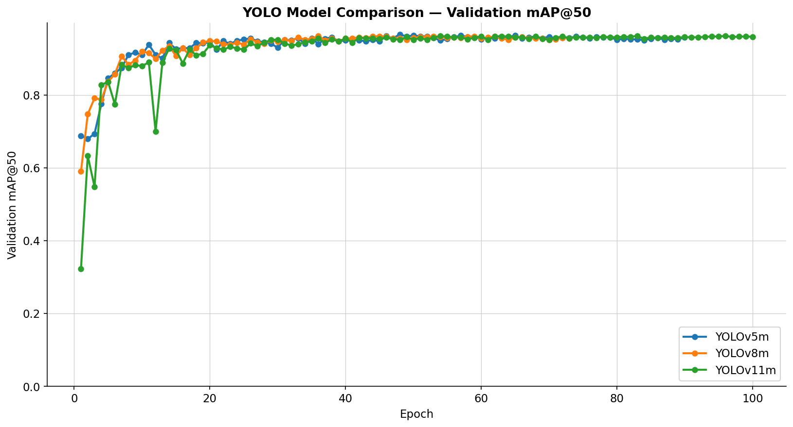

# Deep Learning for Visual Computing

Three computer vision projects from *Deep Learning for Visual Computing* at TU Wien
(team of 2, group 20): brain-tumor detection on MRI, image classification, and
semantic segmentation.

## 1. Brain-tumor detection on MRI (`assignment_3/`)

Compared three generations of YOLO object detectors on the
[MRI for Brain Tumor with Bounding Boxes](https://www.kaggle.com/datasets/ahmedsorour1/mri-for-brain-tumor-with-bounding-boxes)
dataset: 5,249 annotated MRI scans, 4 classes (glioma, meningioma, pituitary, no tumor).
All three models were trained with identical hyperparameters and early stopping on
validation mAP@50, then evaluated on a held-out test set of 948 images.

| Model | mAP@50 | mAP@50-95 | Precision | Recall | Params |
|---|---|---|---|---|---|
| YOLOv5m | 0.946 | 0.760 | 0.925 | 0.921 | ~25M |
| YOLOv8m | 0.938 | 0.749 | 0.924 | 0.903 | ~25M |
| **YOLOv11m** | **0.951** | **0.763** | 0.919 | **0.928** | **20M** |

- **YOLOv11m was the most accurate and the smallest model.**
- **Glioma was the hardest class** for every model (AP@50 0.87–0.89). Gliomas are irregular, which makes bounding boxes harder to place. "No tumor"
  was very high (AP@50 > 0.986).
- Includes our own trainer classes and metrics code (IoU, AP) alongside Ultralytics.

Setup, training and evaluation commands: [`assignment_3/README.md`](assignment_3/README.md).

## 2. CIFAR-10 classification: ResNet-18 vs. CNN vs. Vision Transformer (`assignment_1/`)

Trained a ResNet-18, a custom CNN and a Vision Transformer from scratch on CIFAR-10,
then studied what actually fixes overfitting.

| Model (test accuracy) | No augmentation | With augmentation |
|---|---|---|
| ResNet-18 | 75.9% | 81.9% |
| Custom CNN | 80.2% | **84.2%** |
| Vision Transformer | 62.0% | 59.4% |

- Without augmentation, ResNet-18 reached around 100% training accuracy but only 75.9% on test.
- **The ViT trailed the CNNs** and did not benefit from augmentation within 30 epochs.
  Trained from scratch on a small dataset, it lacks the built in image priors that
  convolutions provide.
- Also compared optimizers (AdamW best, SGD about 5 points behind) and learning rate schedulers.

## 3. Semantic segmentation on Oxford-IIIT Pets (`assignment_2/`)

FCN and SegFormer models segmenting pets from background, comparing training from
scratch vs. starting from pre-trained weights and full fine tuning vs. a frozen encoder.

| Model | Best validation mIoU |
|---|---|
| FCN, from scratch | 0.585 |
| **FCN, pre-trained** | **0.687** |
| SegFormer, from scratch | 0.644 |
| SegFormer, pre-trained (fine-tuned) | 0.653 |
| SegFormer, pre-trained (frozen encoder) | 0.553 |

Pre-training helped most for the FCN (+0.10 mIoU). Freezing the encoder:
the pre-trained features needed fine-tuning for this task.

## Tech

Python, PyTorch, Ultralytics YOLO, torchvision, pandas, matplotlib
